# TAS4 — Red de contenedores MySQL y phpMyAdmin

**Asignatura:** Tendencias Tecnológicas · **Semana:** 4  
**Estudiante:** Pablo Ortega · **Curso:** 4.º semestre  
**Instituto:** Sudamericano · **Carrera:** Desarrollo de Software  
**Fecha:** 6 de noviembre de 2026

## 1. Objetivo

Crear dos contenedores, uno para MySQL y otro para phpMyAdmin, conectarlos mediante una red personalizada de Docker y crear una base de prueba desde la interfaz web. La práctica se realizó en Windows con Docker Desktop y contenedores Linux.

La actividad aparece en Semana 4 y se titula TAS4. Aunque el texto de entrega de la plataforma menciona «semana 3», este informe corresponde a la actividad de MySQL y phpMyAdmin mostrada en la consigna.

## 2. Fundamentos y configuración final

MySQL es el servidor que administra y almacena la información. phpMyAdmin es una aplicación web que envía instrucciones a ese servidor. Cada uno se ejecuta en su propio contenedor, creado desde una imagen oficial.

Una red bridge definida por el usuario permite que los contenedores conectados se comuniquen y se encuentren por sus nombres. En esta práctica phpMyAdmin utiliza el nombre de servicio `mysql`; Docker lo resolvió a `172.18.0.2`. Las IP observadas son dinámicas: la configuración utiliza el nombre del servicio, por lo que no depende de conservar esa IP. [1]

| Elemento | Configuración comprobada |
| --- | --- |
| Docker Engine | 29.4.1, contexto desktop-linux |
| Docker Compose | v5.1.3 |
| Servidor | tas4_mysql, imagen mysql:8.4, versión ejecutada 8.4.13 |
| Interfaz web | tas4_phpmyadmin, imagen phpmyadmin:5.2.3-apache |
| Red personalizada | tas4_red, driver bridge, subred 172.18.0.0/16 |
| Direcciones observadas | MySQL: 172.18.0.2; phpMyAdmin: 172.18.0.3 |
| Acceso desde Windows | http://127.0.0.1:8084 |
| Conexión interna | phpMyAdmin → mysql:3306 |
| Almacenamiento | tas4_mysql_data montado en /var/lib/mysql |
| Base y tabla | prueba_tas4.productos |

El navegador accede al puerto 8084 de Windows, que Docker dirige al puerto 80 de phpMyAdmin. La aplicación se comunica después con MySQL por el puerto 3306 dentro de la red. MySQL no tiene un puerto publicado en Windows.

## 3. Preparación y credenciales

Docker Desktop estaba detenido al iniciar la práctica; se abrió y se esperó a que su motor estuviera disponible. Se comprobaron las versiones, el contexto y la sintaxis del archivo Compose:

```powershell
docker version --format 'Cliente: {{.Client.Version}} | Servidor: {{.Server.Version}}'
docker context show
docker compose version
docker compose --env-file .env.local config --services
docker compose --env-file .env.local config --quiet
```

Se generaron contraseñas para root y para el usuario MySQL `pablo`. Los valores se guardan únicamente en `.env.local` y en un archivo privado de acceso; están excluidos de Git mediante `.gitignore`. El archivo público `.env.example` contiene marcadores para que otra persona elija sus propias claves.

El usuario MySQL llamado pablo es independiente del usuario pablo de Ubuntu. No comparten la contraseña.

| Variable | Uso |
| --- | --- |
| MYSQL_ROOT_PASSWORD | Contraseña administrativa inicial de MySQL |
| MYSQL_USER | Usuario de trabajo: pablo |
| MYSQL_PASSWORD | Contraseña de ese usuario |
| PMA_HTTP_PORT | Puerto local de la interfaz: 8084 |
| PMA_HOST | Nombre del servidor al que se conecta phpMyAdmin: mysql |
| PMA_PORT | Puerto de MySQL dentro de la red: 3306 |

Las variables de inicialización de la imagen MySQL se aplican al crear un directorio de datos nuevo. Editar el archivo de variables después no cambia por sí mismo una contraseña ya almacenada en un volumen existente. [2]

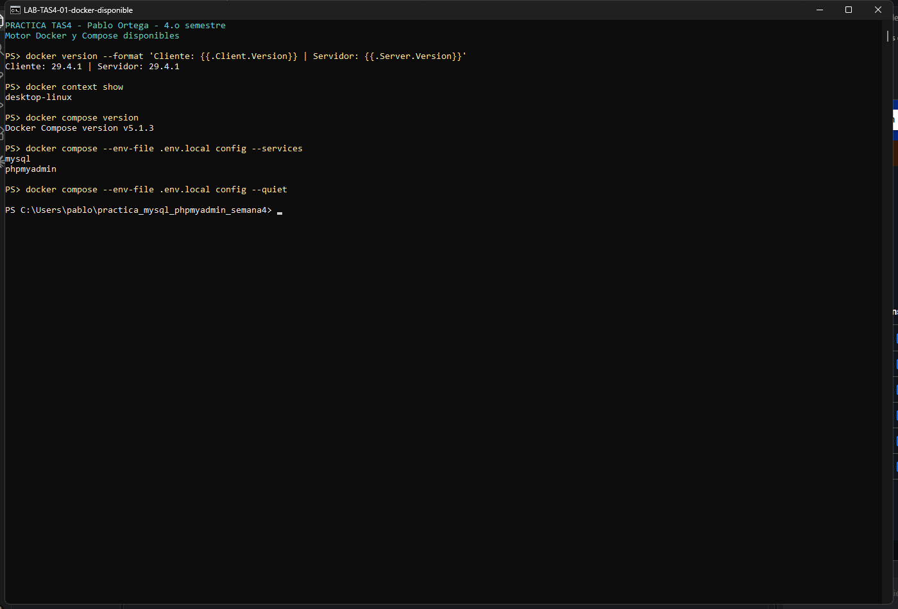

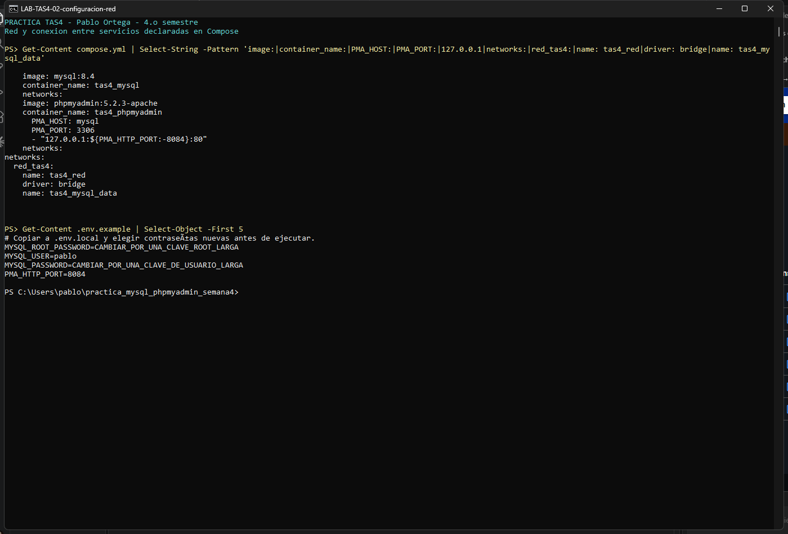

## 4. Crear los servicios y la red personalizada

El archivo [compose.yml](compose.yml) define ambos servicios, la red y el volumen. Los fragmentos principales son:

```yaml
services:
  mysql:
    image: mysql:8.4
    container_name: tas4_mysql
    networks:
      - red_tas4

  phpmyadmin:
    image: phpmyadmin:5.2.3-apache
    container_name: tas4_phpmyadmin
    environment:
      PMA_HOST: mysql
      PMA_PORT: 3306
    ports:
      - "127.0.0.1:8084:80"
    networks:
      - red_tas4

networks:
  red_tas4:
    name: tas4_red
    driver: bridge
```

Este fragmento resume la conexión; el archivo completo incluye contraseñas por variables privadas, volumen, límites de recursos, reinicio y comprobación de salud.

Se descargaron las imágenes y se desplegó la configuración:

```powershell
docker compose --env-file .env.local pull
docker compose --ansi never --env-file .env.local up -d --wait --wait-timeout 180
docker compose --env-file .env.local ps
```

Compose creó la red tas4_red y conectó los dos contenedores durante su creación. También creó el volumen tas4_mysql_data. El healthcheck ejecuta una consulta local de MySQL; phpMyAdmin espera a que el servidor alcance el estado healthy.

Se asignó un límite de 1 GiB y una CPU a MySQL, y de 256 MiB y media CPU a phpMyAdmin. Son límites del laboratorio; no representan una medición de consumo ni una recomendación de capacidad para producción.

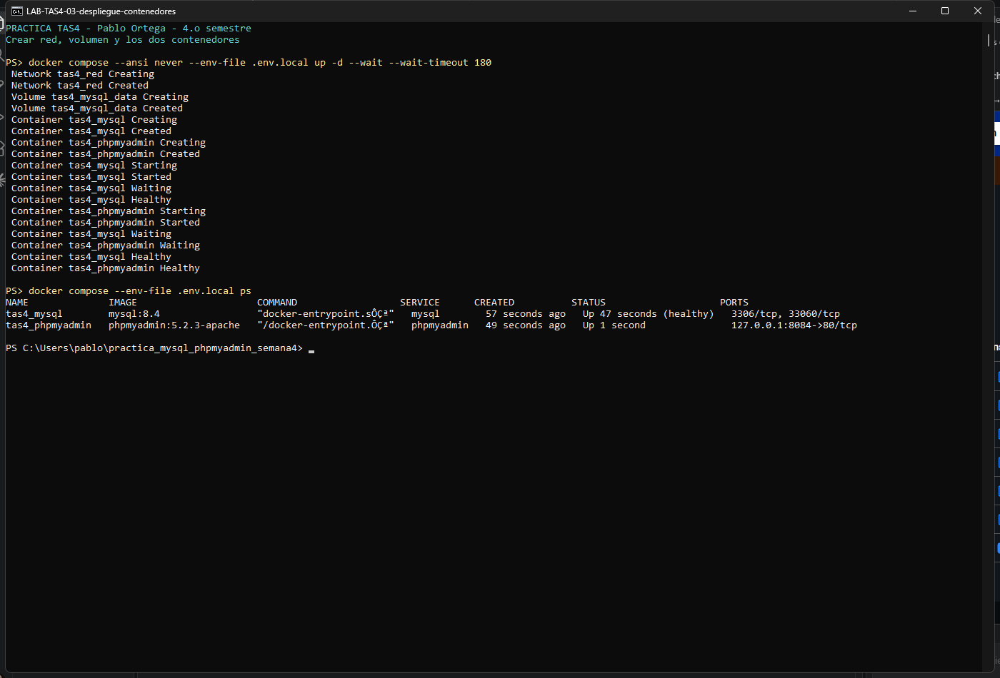

## 5. Comprobar la red y preparar el usuario

Se revisó qué contenedores pertenecen a la red:

```powershell
docker network inspect tas4_red --format '{{range .Containers}}{{.Name}} -> {{.IPv4Address}}{{println}}{{end}}'
```

El resultado mostró tas4_mysql con 172.18.0.2/16 y tas4_phpmyadmin con 172.18.0.3/16.

El usuario pablo se creó al inicializar MySQL. Antes de crear la base desde la web, se le concedieron permisos de trabajo sobre prueba_tas4:

```sql
GRANT ALL PRIVILEGES ON prueba_tas4.* TO 'pablo'@'%';
SHOW GRANTS FOR 'pablo'@'%';
```

La instrucción se ejecutó administrativamente dentro de MySQL mediante [sql/01_permisos.sql](sql/01_permisos.sql). El símbolo % de la cuenta permite que el usuario se autentique desde la dirección del otro contenedor. El servidor sigue sin publicar su puerto en Windows.

Se comprobó previamente que prueba_tas4 no existía. El permiso permite crearla desde phpMyAdmin, sin utilizar root para la sesión web.

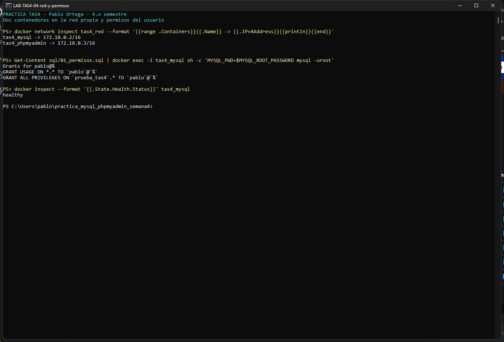

## 6. Conectar phpMyAdmin con MySQL

Se abrió [http://127.0.0.1:8084](http://127.0.0.1:8084) y se inició sesión con el usuario MySQL pablo y su contraseña privada.

`PMA_HOST=mysql` indica el nombre del servidor; `PMA_PORT=3306` indica su puerto interno. La imagen de phpMyAdmin admite estas variables para configurar la conexión. [3]

Dentro del contenedor phpMyAdmin, localhost identificaría a ese mismo contenedor. Por eso se utiliza el nombre mysql para llegar al servicio de base de datos. El 127.0.0.1 que se escribe en el navegador identifica, en cambio, al equipo Windows desde el que se accede a la aplicación.

La página inicial confirmó una sesión conectada al servidor MySQL de la práctica.

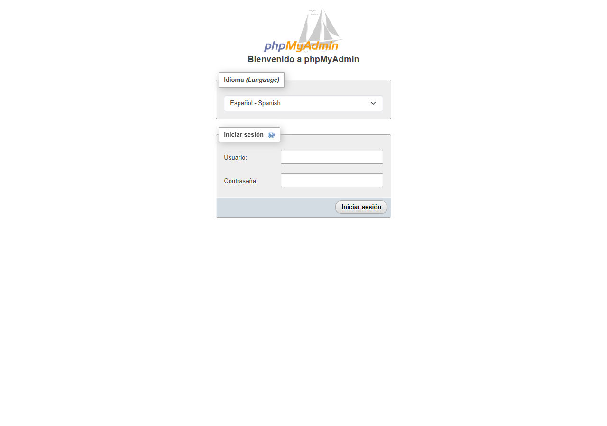

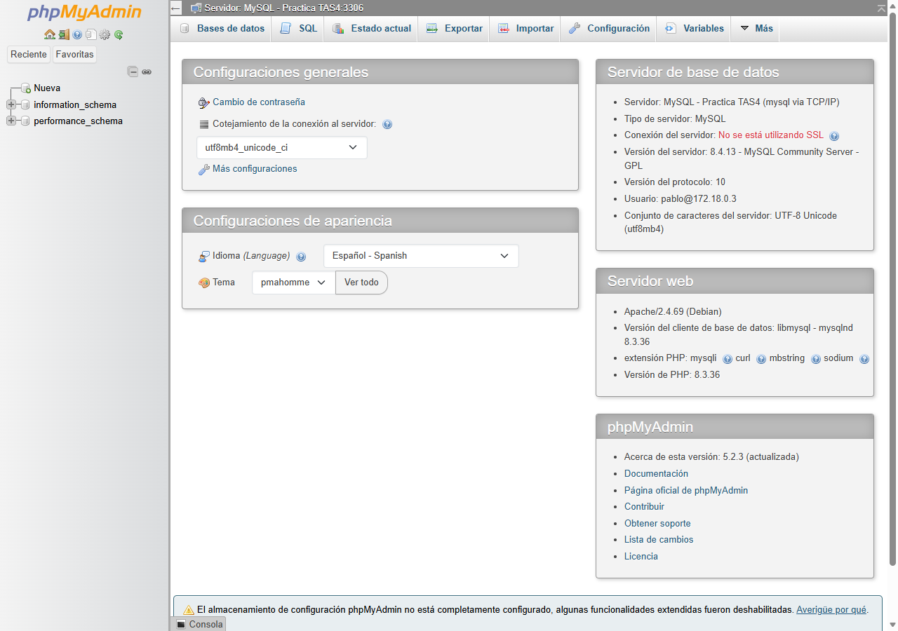

## 7. Crear la base desde la interfaz

En phpMyAdmin se abrió Bases de datos y se completó el formulario con:

| Campo | Valor |
| --- | --- |
| Nombre de la base | prueba_tas4 |
| Cotejamiento | utf8mb4_unicode_ci |

Se pulsó Crear. La base apareció en la navegación y la interfaz indicó que todavía no contenía tablas. Esta creación se realizó desde el formulario web, cumpliendo el paso solicitado.

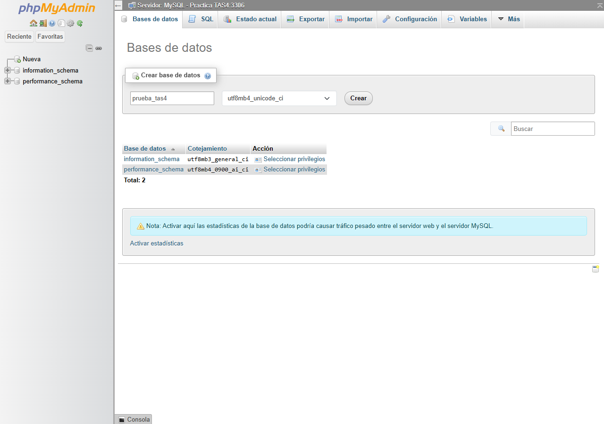

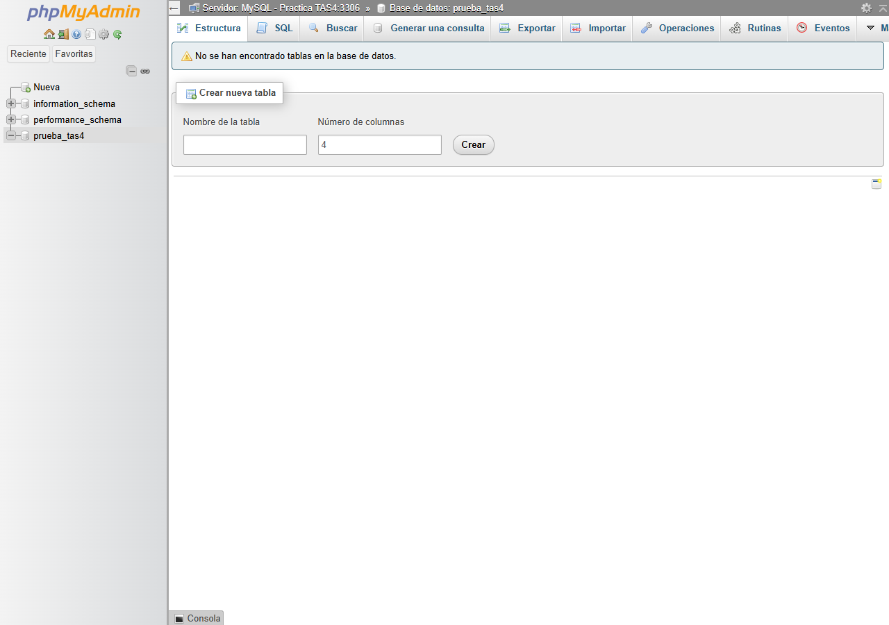

## 8. Crear una tabla e insertar datos de prueba

Como comprobación adicional se abrió la pestaña SQL de la nueva base y se ejecutó el contenido de [sql/02_datos_prueba.sql](sql/02_datos_prueba.sql):

```sql
USE prueba_tas4;

CREATE TABLE productos (
  id INT UNSIGNED AUTO_INCREMENT PRIMARY KEY,
  nombre VARCHAR(80) NOT NULL,
  precio DECIMAL(10,2) NOT NULL
);

INSERT INTO productos (nombre, precio) VALUES
  ('Cuaderno', 2.50),
  ('Lapiz', 0.75),
  ('Carpeta', 1.25);

SELECT id, nombre, precio FROM productos ORDER BY id;
```

CREATE TABLE define la estructura; AUTO_INCREMENT genera identificadores y PRIMARY KEY los identifica de forma única. VARCHAR almacena el nombre y DECIMAL(10,2) permite guardar el precio con dos decimales. INSERT añade los registros y SELECT permite comprobarlos.

phpMyAdmin mostró la creación de la tabla, tres filas insertadas y el resultado de la consulta:

| id | nombre | precio |
| --- | --- | --- |
| 1 | Cuaderno | 2.50 |
| 2 | Lapiz | 0.75 |
| 3 | Carpeta | 1.25 |

Los valores son ficticios y se utilizan únicamente como datos de prueba.

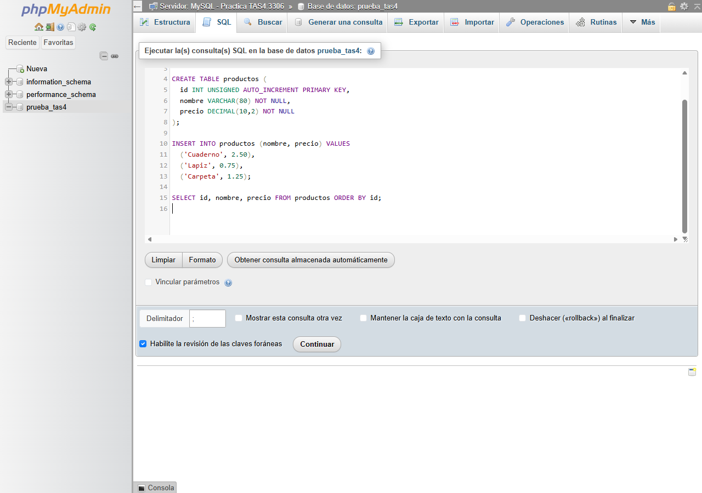

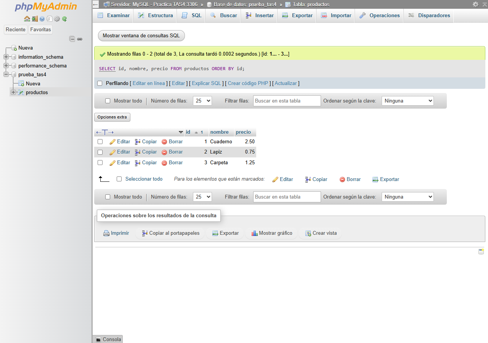

## 9. Verificar la comunicación y el resultado final

Se ejecutó [scripts/verificar_red.php](scripts/verificar_red.php) dentro del contenedor phpMyAdmin. El programa resolvió el nombre mysql, abrió una conexión TCP al puerto 3306, se autenticó como pablo y consultó los tres productos.

```powershell
docker cp scripts/verificar_red.php tas4_phpmyadmin:/tmp/verificar_red.php
docker exec --env-file .local/php-cliente.env tas4_phpmyadmin php /tmp/verificar_red.php
```

El archivo privado php-cliente.env contiene solo el usuario y la contraseña de trabajo. Para recrearlo y ejecutar las comprobaciones se proporciona [scripts/verificar.ps1](scripts/verificar.ps1).

El resultado confirmó DNS mysql → 172.18.0.2, TCP 3306 accesible, MySQL 8.4.13, base prueba_tas4, usuario pablo@% y tres filas. Esta consulta demuestra una comunicación real desde un contenedor al otro.

Se revisaron también el estado, los puertos, el volumen y los datos:

```powershell
docker compose --env-file .env.local ps
docker port tas4_phpmyadmin
docker port tas4_mysql
docker inspect tas4_mysql --format '{{range .Mounts}}{{.Type}} {{.Name}} -> {{.Destination}}{{println}}{{end}}'
Get-Content sql/03_verificar.sql | docker exec -i tas4_mysql sh -c 'MYSQL_PWD=$MYSQL_ROOT_PASSWORD mysql -uroot'
```

El puerto 80 de phpMyAdmin está publicado en 127.0.0.1:8084. docker port tas4_mysql no devuelve una asignación porque MySQL se utiliza por la red interna. Que docker ps muestre 3306/tcp no significa que ese puerto esté publicado en Windows.

El volumen está montado en /var/lib/mysql. Se comprobó su asociación; esta práctica no realizó una eliminación y recreación del contenedor para ensayar persistencia. Los digests de las imágenes ejecutadas se conservan en [imagenes.lock.json](imagenes.lock.json).

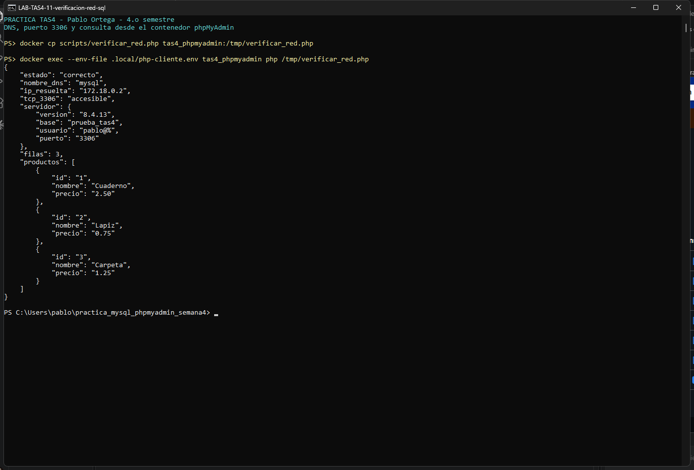

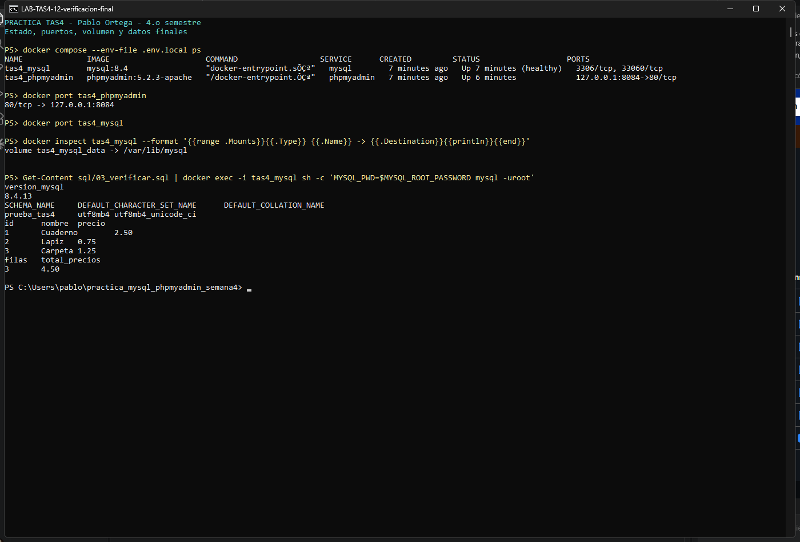

## 10. Resultados y conclusiones

Las trece comprobaciones de [evidencias/resultados.json](evidencias/resultados.json) fueron correctas. Entre ellas se verificaron los servicios en ejecución, la red compartida, DNS, conexión TCP, autenticación, creación desde la interfaz, tres registros, publicación local de la web y montaje del volumen.

**Administración de servicios.** Separar MySQL y phpMyAdmin permite distinguir el servidor de datos de la aplicación que lo administra. Compose registra su configuración y el orden de inicio.

**Red de contenedores.** La red personalizada permite utilizar el nombre mysql para llegar al servidor sin fijar su IP. El puerto 8084 del navegador y el puerto 3306 de MySQL pertenecen a conexiones diferentes.

**Comprobación funcional.** La base se creó desde el formulario web y la tabla se probó con datos. La consulta desde el propio contenedor phpMyAdmin confirmó que la conexión no era solamente una configuración escrita en un archivo.

## 11. Dificultades y decisiones

Docker Desktop estaba detenido: se inició antes de descargar y ejecutar las imágenes. La primera consulta administrativa se intentó mientras MySQL todavía se inicializaba; se esperó al estado healthy y se repitió correctamente.

Para la carga SQL fue necesario dirigir la entrada al editor principal del formulario. Se comprobó que la consulta estuviera visible antes de pulsar Continuar y se verificaron después los registros tanto en la web como mediante SQL.

Las contraseñas se mantienen fuera de la entrega. La interfaz solo se publica en loopback. El usuario de trabajo tiene permisos sobre la base de la práctica y el volumen conserva sus archivos de datos.

## 12. Reproducción y entrega

En otro equipo con Docker Desktop, se copia .env.example a .env.local y se definen contraseñas nuevas. Se ejecuta:

```powershell
powershell -ExecutionPolicy Bypass -File scripts/iniciar.ps1
```

Después se abre phpMyAdmin, se crea prueba_tas4 desde Bases de datos y se ejecuta el SQL de prueba una sola vez. El script de inicio no elimina datos existentes.

Para detener los servicios sin eliminar el volumen:

```powershell
docker compose --env-file .env.local stop
```

Para iniciarlos de nuevo:

```powershell
docker compose --env-file .env.local up -d
```

La entrega de la plataforma solicita un enlace a este informe Markdown y, por separado, un audio MP3 de 60 segundos o más. [guion_audio.md](guion_audio.md) prepara el contenido para una grabación personal; no sustituye el archivo de voz que debe adjuntarse.

## 13. Fuentes

Documentación primaria consultada el 6 de noviembre de 2026:

[1] [Docker. Bridge network driver](https://docs.docker.com/engine/network/drivers/bridge/)

[2] [Docker Official Images. MySQL: variables e inicialización](https://hub.docker.com/_/mysql)

[3] [Docker Official Images. phpMyAdmin: configuración de conexión](https://hub.docker.com/_/phpmyadmin)

[4] [phpMyAdmin. Instalación mediante Docker y variables de entorno](https://docs.phpmyadmin.net/en/latest/setup.html#installing-using-docker)

